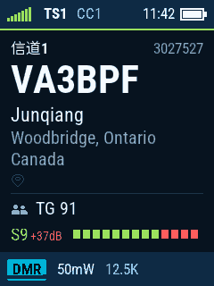
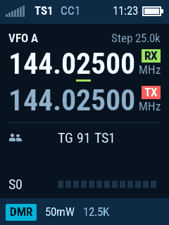
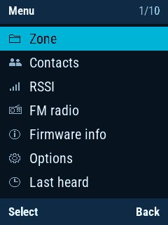
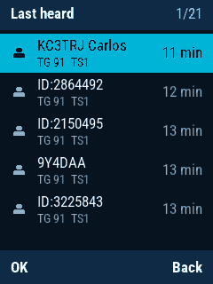
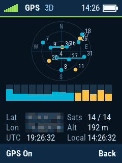
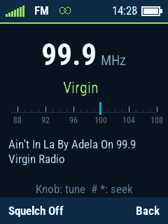

# OpenDMR — firmware abierto para el Baofeng DM-32UV

[中文](README.md) · **[Guía de instalación](docs/installation.es.md)** · **[Manual de usuario](docs/manual.es.md)** · **[English](README.en.md)**

Firmware abierto para el **Baofeng DM-32 / DM-32UV** (SoC **HR_C7000** = CPU CK803S + módem DMR + códec de audio).
El código fuente es abierto: libre de usar, modificar y compartir para fines no comerciales; el uso comercial necesita el
permiso del autor (véase "Licencias").

- Reescrito sobre FreeRTOS. Las funcionalidades provienen del OpenDM32 de RA4FHE (Alexey) (el puerto del DM-32 de
  OpenGD77, sobre uC/OS-III);
- Nueva interfaz de usuario (nativa 240×320, Inglés / Chino / Español);
- DMR usa nuestro propio códec AMBE+2 compatible (el submódulo `vocoder/`), P25 nuestro propio códec IMBE e interfaz de
  aire (el submódulo `p25/`): **sin ningún código del firmware original**.

Funcionalidades: recepción y transmisión DMR / FM / **P25** (grupos simplex de Fase 1), canales y VFO, escaneo, doble
vigilancia, contactos, últimos escuchados, radio FM, GPS, balizas APRS, pases de satélites de radioaficionado, punto de
acceso DMR (MMDVM), VOX, teclas definidas por el usuario, ... Véase el
[manual de usuario](docs/manual.es.md).

<p align="center">
  
  
  
</p>
<p align="center">
  
  
  
</p>

> ⚠️ **Flashear puede dejar la radio inutilizable; lo hace bajo su propio riesgo. Antes de flashear cualquier cosa,
> haga una copia de seguridad de ambos chips SPI flash** (sección 2 de la [guía de instalación](docs/installation.es.md)).
> La copia tiene **la calibación de transmisión y recepción propia de esta radio**, que no se puede recuperar de otra
> radio.

---

## Instalación

Usuarios: descargue el paquete desde [Releases](../../releases) y siga la
[guía de instalación](docs/installation.es.md) (copia de seguridad → firmware y fuente china → codeplug con el CPS de
OpenGD77).

## Diseño

| Ruta | Contenido |
|---|---|
| `src/` | El código fuente del firmware (`make`, véase abajo) |
| `vocoder/` | Submódulo, repositorio [va3bpf/dmr-vocoder](https://github.com/va3bpf/dmr-vocoder): nuestro códec DMR (compatible AMBE+2): algoritmo, verificación en Python, C de punto fijo (`c/ambe/`, usado por el firmware), pruebas, documentos |
| `p25/` | Submódulo, repositorio [va3bpf/p25-core](https://github.com/va3bpf/p25-core): la interfaz de aire y el códec IMBE de P25 Fase 1 (marcos, corrección de errores), código C y pruebas en la PC; el lado de la radio está en [docs/p25.md](docs/p25.md) (en chino) |
| `docs/` | [Guía de instalación](docs/installation.es.md), [manual de usuario](docs/manual.es.md) (capturas en `docs/manual/`); documentos de desarrollo: [architecture.md](docs/architecture.md) (arquitectura, en chino), [ui-design.md](docs/ui-design.md) (interfaz de usuario), [coding-style.md](docs/coding-style.md), [fd6818-registers.md](docs/fd6818-registers.md) (registros del chip RF), [i18n.md](docs/i18n.md) (idiomas: el diseño, léalo para añadir uno) |
| `tools/backup/` | `dm32_dump.py`: herramienta de copia / escritura a través del bootloader del chip (y `dumper/`, que sube a la radio) |
| `tools/debug/` | Actualización por cable `fw_update.py` (y `updater/`), comandos de depuración `dm32dbg.py`, capturas `fshot.py`, teclas simuladas `fkey.py`, nivel de micrófono `miclevel.py`, ... |
| `tools/fonts/` | Conversión de fuentes (`mkfont.py`), fuente china (`mkcjk.py` → `build/cjk.bin`, `upload_cjk.py` la escribe en la radio) |
| `tools/text/` | El generador de tablas de texto de interfaz y los archivos originales de idiomas (de OpenGD77) |
| `tools/satellite/` | Escribe los keps de satélites (`write_keps.py`) |
| `tools/release/` | El script de versión `make_release.py` |

---

## Compilación

1. Obtenga el código fuente (el vocoder y P25 son submódulos):

   ```powershell
   git clone --recursive https://github.com/va3bpf/OpenDMR.git
   ```

   La rama por defecto es `develop`, donde ocurre el desarrollo; para el código de las versiones use `-b main` (o
   `-b v<versión>`). En un clonado hecho sin `--recursive`: `git submodule update --init` en la raíz.

2. La toolchain (no está en el repositorio): **Xuantie-800 GCC 13.3.0 (csky-elfabiv2)**, parte del C-Sky Development
   Suite (CDS) 5.2.21: descárguelo (tras registrarse) desde
   <https://www.xrvm.cn/community/download?versionId=4498138066258563072>. Coloque la carpeta MinGW del CDS en
   `toolchain/` en la raíz del repositorio, de modo que haya
   `toolchain/MinGW/csky-elfabiv2-tools/bin` y `toolchain/MinGW/msys/1.0/bin` (make).

3. Ponga ambas en el PATH y ejecute `make` en `src/`:

   ```powershell
   $env:PATH = "$PWD\toolchain\MinGW\csky-elfabiv2-tools\bin;$PWD\toolchain\MinGW\msys\1.0\bin;$env:PATH"
   cd src; make
   ```

La salida es `src/build/opendmr.bin` (y `.elf`, `.map`, y `opendmr_BFUV32.bin` con la cabecera del modo de actualización
de fábrica). El vocoder se compila directamente desde `vocoder/c/ambe/` mediante `src/Makefile`. La fuente china:
`py tools/fonts/mkcjk.py` → `tools/fonts/build/cjk.bin`.

## Flasheo (desarrollo)

- Primera instalación, o una radio que no arranca: `dm32_dump.py --write` (radio apagada, ejecute, encienda dentro de
  30 s); véase sección 3 de la [guía de instalación](docs/installation.es.md):

  ```powershell
  py -u tools\backup\dm32_dump.py COM6 program src\build\opendmr.bin --write --start 0xC000
  py -u tools\backup\dm32_dump.py COM6 data tools\fonts\build\cjk.bin --write --start 0x280000
  ```

- De lo contrario, con OpenDMR corriendo y el cable conectado:
  `py tools\debug\fw_update.py src\build\opendmr.bin --port COM6`.
  Sólo se escriben los sectores cambiados (unos 35 s), la radio se reinicia al final.

## Ramas y versiones

- **`develop`**: la rama de desarrollo, donde se integran los cambios (enviar pull requests a `develop`);
- **`main`**: sólo versiones. `develop` se integra en ella una vez probado, y cada versión se etiqueta como `v<versión>` en
  `main`.

```powershell
git switch main; git merge develop; git push      # antes de una versión: develop a main
py tools\release\make_release.py              # construye, empaqueta dist\OpenDMR-<versión>.zip y SHA256SUMS.txt
py tools\release\make_release.py --publish    # también la versión de GitHub (etiqueta v<versión>; gh auth login, HEAD push)
```

El paquete contiene lo que la tabla en la sección 1 de la [guía de instalación](docs/installation.es.md) lista. El
script rechaza un árbol de trabajo con cambios sin confirmar (el firmware muestra el commit del que fue compilado);
`--publish` funciona sólo en `main`, una vez `main` subida.

---

## Proyectos relacionados

| Proyecto | Para qué |
|---|---|
| [OpenGD77](https://www.opengd77.com/) | De dónde viene este firmware (motor DMR, punto de acceso, textos de la interfaz); su CPS escribe el codeplug |
| OpenDM32 (RA4FHE), [foro](http://infotex58.ru/forum/index.php?topic=1168.0) | El puerto del DM-32 de OpenGD77, referencia de las funcionalidades |
| [rogerclarkmelbourne/DM32](https://github.com/rogerclarkmelbourne/DM32) | Scripts de copia / escritura de flash del DM-32 (el protocolo del bootloader) |
| [M7OCM/DM-32UV](https://github.com/M7OCM/DM-32UV) | Archivo de CPS y firmware originales (para volver al firmware de fábrica) |
| [infamy/DM32-Protocol-Spec](https://github.com/infamy/DM32-Protocol-Spec) | El protocolo de programación del DM-32 |
| [gzalo/RadioFoundry](https://github.com/gzalo/RadioFoundry) | Otro firmware DMR abierto con soporte DM-32UV |

## Licencias

Cada archivo decide por su cabecera; el texto completo está en [LICENSE](LICENSE):

| Parte | Licencia |
|---|---|
| Nuestros propios archivos (cabecera con `Copyright (C) 2026 Junqiang Shi, VA3BPF / BG8AM` únicamente: la mayor parte de `src/`, incluidos los archivos reescritos marcados `After OpenDM32 ...`), `tools/` | Licencia BSD-style, cláusula 4: **uso comercial sólo con permiso por escrito de Junqiang Shi (VA3BPF)** |
| Código tomado de OpenGD77 (`src/dmr/hr_c7000.*`, `src/dmr/codec.*`, `src/dmr/dmr*.c/h`, `src/services/hotspot.c`, `src/hal/util.h`; los autores originales se mantienen en las cabeceras) | Licencia BSD-style de OpenGD77, **cláusula 4: sin uso comercial** |
| Archivos tomados en parte de OpenDM32 (`src/graphics/font_cjk.c`, `src/services/fm_broadcast.c`, `src/services/debug.c`; copyright de contribuyentes de OpenDM32 + Junqiang Shi) | Igual, **sin uso comercial** |
| `src/startup/crt0.S` | Archivo de inicio de C-SKY, sin declaración de licencia |
| `src/graphics/fonts/roboto*.c`, `src/ui/text/text*` | Datos generados (fuentes de abajo; las tablas de texto vienen de los archivos de idiomas de OpenGD77) |
| `src/freertos/` | FreeRTOS, MIT |
| `vocoder/` | Propio; el decodificador está portado de mbelib (ISC). AMBE+2 es tecnología patentada de DVSI: busque las patentes antes de cualquier uso comercial |
| `p25/` | Propio; la decodificación de parámetros IMBE y las tablas están portadas de mbelib, las posiciones en los marcos de DSD (ISC). IMBE es tecnología de DVSI también: lo mismo |
| Fuentes `tools/fonts/ttf/` | Roboto Condensed y Noto Sans SC, ambas SIL Open Font License 1.1 (los textos de licencia en la misma carpeta) |

Así que el firmware como un todo **no se puede usar comercialmente** por ahora: eso necesitaría al menos un nuevo motor DMR
y punto de acceso, y verificar las patentes de AMBE+2.

## Agradecimientos

RA4FHE (Alexey), el autor de OpenDM32, dijo en el foro que el código puede distribuirse y modificarse libremente.
Gracias a Roger Clark VK3KYY, Kai Ludwig DG4KLU y los otros autores de OpenGD77, a andynvkz (OpenUV008, herramientas de
flash), y a todos en el hilo del foro del DM-32.
