# OpenDMR manual de usuario

Para el **Baofeng DM-32 / DM-32UV** con el firmware OpenDMR. Versión en chino: [manual.md](manual.md). Versión en
inglés: [manual.en.md](manual.en.md).

Cada imagen es una captura real de la radio (`tools/debug/fshot.py`, 240×320). En las pantallas de GPS y de información
de la radio la posición está difuminada.

> Este manual corresponde a la versión 25340747 del firmware (2026-11-07). Instalar, actualizar y volver al firmware
> original: la [guía de instalación](installation.es.md).
> **Haga la copia de seguridad de los dos chips flash antes de flashear cualquier cosa**: la copia guarda la
> calibración propia de esta radio.

## Contenido

1. [Teclas](#1-teclas)
2. [La pantalla](#2-la-pantalla)
3. [Modo canal](#3-modo-canal)
4. [Modo VFO](#4-modo-vfo)
5. [Recepción](#5-recepción)
6. [Transmisión](#6-transmisión)
7. [Escaneo](#7-escaneo)
8. [Doble vigilancia](#8-doble-vigilancia)
9. [Contactos y a quién se llama](#9-contactos-y-a-quién-se-llama)
10. [El menú principal](#10-el-menú-principal)
11. [Opciones](#11-opciones)
12. [Bloqueo, teclas rápidas, ajustes de teclas](#12-bloqueo-teclas-rápidas-ajustes-de-teclas)
13. [CPS, hotspot, actualización](#13-cps-hotspot-actualización)
14. [Límites actuales](#14-límites-actuales)

---

## 1. Teclas

| Tecla | Qué hace |
|---|---|
| **Tecla de menú** (izquierda, bajo la pantalla) | Menú / OK. En las pantallas principales una **pulsación corta abre el menú de esa pantalla** (menú rápido), una **pulsación larga abre el menú principal** |
| **Tecla de retorno** (derecha, bajo la pantalla) | Volver / borrar un dígito. **Pulsación larga: pantalla principal.** En la pantalla de canal una pulsación corta va a la VFO, en la VFO vuelve al canal |
| ▲ ▼ | Canal (modo canal), frecuencia (VFO), moverse en las listas |
| ◀ ▶ | Cambiar el valor de la fila seleccionada en las listas; en las pantallas principales el grupo de llamada (DMR) o el squelch (FM) |
| Perilla | Igual que ▲ ▼ |
| SK1, SK2 (teclas laterales) | Solas tienen su propia función; pulsadas junto a otra tecla forman combinaciones (abajo) |
| PTT | Transmitir |
| Dígitos, *, # | Números de canal, frecuencias, números; atajos en las pantallas principales |

Las dos etiquetas de la barra inferior dicen qué hacen la tecla de menú y la de retorno en esa pantalla (Seleccionar, OK,
Guardar, Editar, Volver, Borrar, ...).

### Atajos en las pantallas principales (por defecto)

Todos se pueden cambiar en Opciones → Ajustes de teclas (ver [12](#12-bloqueo-teclas-rápidas-ajustes-de-teclas)).

| Teclas | DMR | FM |
|---|---|---|
| # | Introducir un número de grupo de llamada / llamada privada | Introducir DTMF |
| SK2 + # | Lista de contactos | Lista de contactos DTMF |
| # largo | Repetidora inversa (sólo en modo canal) | Igual |
| * | Timeslot | Ancho de banda 12.5 / 25 kHz |
| * largo | Volver al timeslot propio del canal | — |
| SK1 + * | Modo: FM → AM → USB → LSB → DMR → P25 | Igual |
| ▶ / ◀ | Grupo de llamada + / − (a través de la lista de grupos de RX) | Squelch + / − |
| SK2 + ▶ / ◀ | Potencia + / − | Igual |
| SK2 + ▶ largo | Potencia de usuario | Igual |
| SK2 + ▲ / ▼ | Zona + / − (modo canal); frecuencia de transmisión + / − (VFO) | Igual |
| SK2 sola | Devolver la llamada al grupo de llamada recién escuchado | — |
| SK1 sola | Radio FM | Igual |
| SK1 + ▲ / ▼ | Escanear arriba / abajo | Igual |
| SK1 + 1 | APRS activar / desactivar | Igual |
| SK2 + 2 | Enviar una baliza APRS ahora | Igual |

Además: SK2 + tecla de menú abre directamente los detalles del canal; SK2 + un dígito es una tecla rápida (ver
[12](#12-bloqueo-teclas-rápidas-ajustes-de-teclas)).

---

## 2. La pantalla

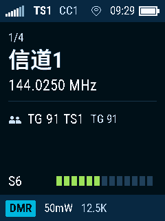 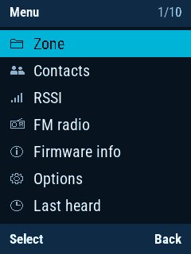

- **Barra de estado** (arriba): barras de señal, timeslot `TS1`/`TS2`, código de color `CC1`, icono de escaneo, hora,
  batería. Una línea verde debajo mientras recibe; toda la barra se pone roja mientras transmite.
- **Área principal**: en la pantalla de canal la zona y la posición, el nombre del canal (grande), la frecuencia, el
  grupo de llamada, el medidor S.
- **Barra inferior**: en las pantallas principales el modo (`DMR`/`FM`/`AM`/`USB`/`LSB`), la potencia y el ancho de
  banda; en las listas lo que hacen las dos teclas.
- **Listas** (menús, ajustes): la barra de título muestra el nombre y la posición (`1/10`), la fila seleccionada es
  naranja, 7 filas por página, ▲ ▼ dan la vuelta en los extremos.

Los colores significan algo: verde = recepción, rojo = transmisión, naranja = seleccionado / actual, ámbar = aviso
(batería baja, escaneo, fin de tiempo cerca).

---

## 3. Modo canal

La radio arranca en modo canal (en la VFO si se la dejó allí).

| Para | Teclas |
|---|---|
| Cambiar de canal | ▲ ▼ o la perilla |
| Ir al canal N de la zona | Escribir el número y la tecla de menú (la de retorno cancela) |
| Cambiar de zona | SK2 + ▲ ▼, o menú principal → Zona |
| Grupo de llamada / squelch | ▶ ◀ |
| Potencia | SK2 + ▶ ◀ |
| Timeslot / ancho de banda | * |
| Ir a la VFO | Tecla de retorno |
| Menú del canal | Tecla de menú |
| Detalles del canal | SK2 + tecla de menú, o la primera fila del menú |

### Menú rápido del canal (tecla de menú)

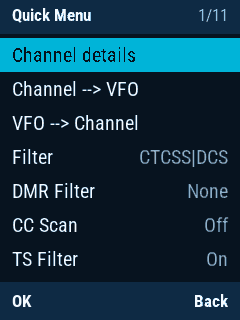 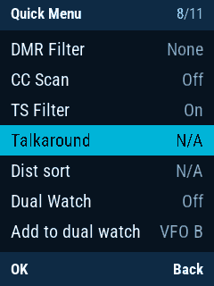

▲ ▼ eligen una fila, ◀ ▶ cambian su valor, la tecla de menú lo aplica y cierra el menú, la tecla de retorno lo cierra
sin cambios.

| Fila | Qué hace |
|---|---|
| Detalles del canal | Todos los ajustes de este canal (abajo) |
| Canal --> VFO | Copia este canal en la VFO en uso y pasa a la VFO |
| VFO --> Canal | Sobrescribe este canal con la VFO en uso (pregunta antes) |
| Filtro | Filtro de tonos analógico: `CTCSS\|DCS` escucha sólo señales con el tono correcto, `Ninguno` escucha todo |
| Filtro DMR | Ninguno / este grupo de llamada / este contacto / los grupos de la lista de grupos de RX |
| Escaneo CC | Activado: encuentra el código de color solo (filtro de código de color desactivado) |
| Filtro TS | Activado: sólo se escucha el timeslot del canal |
| Talkaround | En un canal de repetidora: hablar directo en la frecuencia de recepción |
| Orden por distancia | Canales de la zona en orden de distancia desde usted (necesita su posición) |
| Doble vigilancia | Doble vigilancia activada / desactivada (ver [8](#8-doble-vigilancia)) |
| Añadir a doble vigilancia | Pone este canal en un camino de la doble vigilancia (el camino que reemplaza se muestra a la derecha) |

### Detalles del canal

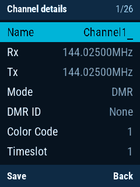 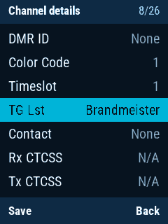 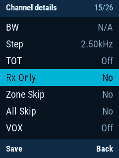 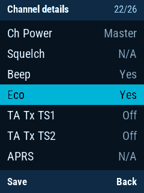

Nombre, frecuencias de recepción y transmisión, modo, DMR ID, código de color (el NAC en un canal P25), timeslot, lista
de grupos, contacto, CTCSS/DCS de recepción y transmisión, ancho de banda, paso, tiempo límite de transmisión, sólo
recepción, saltar zona, saltar todo, VOX, potencia del canal, squelch, pitido, eco, transmisión de alias del hablante
en TS1 / TS2, configuración de APRS.

- ▲ ▼ eligen, ◀ ▶ o la perilla cambian;
- Las frecuencias y el DMR ID se escriben con los dígitos (8 dígitos, ◀ borra uno); ◀ ▶ en Rx / Tx ponen Tx en Rx más el
  desplazamiento de repetidora;
- Nombre: letras en las teclas de dígitos, ◀ ▶ mueven, SK2 + ◀ borra, SK2 + ▶ inserta;
- La lista de grupos, el contacto y la configuración de APRS se eligen por nombre;
- **La tecla de menú guarda** (en el codeplug) y vuelve a inicio; **la tecla de retorno sale sin guardar**.

---

## 4. Modo VFO

La tecla de retorno en la pantalla de canal va a la VFO, otra vez vuelve al canal. Hay dos VFO (A y B): **mantenga la
tecla de retorno** para cambiar, o elíjala en el menú de la VFO.

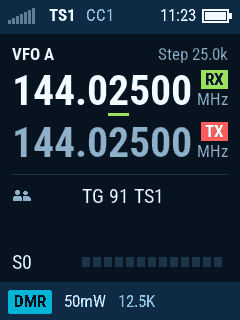 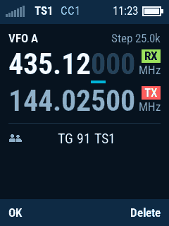

| Para | Teclas |
|---|---|
| Cambiar la frecuencia de recepción | ▲ ▼ o la perilla (un paso) |
| Cambiar la frecuencia de transmisión | SK2 + perilla, o SK2 + ▲ ▼ |
| Escribir una frecuencia | Dígitos (p. ej. `43500000`: se fija tras el 8.º dígito, o con la tecla de menú; la de retorno borra uno) |
| Intercambiar Rx y Tx mientras se mantiene | SK1 + SK2 |
| Modo: FM → AM → USB → LSB → DMR → P25 | SK1 + * |
| Squelch (FM, AM, SSB) / grupo de llamada (DMR, P25) | ▶ ◀ |

La línea superior muestra qué frecuencia se está cambiando (`RX` o `TX`) y el paso.

**AM, USB y LSB son sólo recepción** (el chip de RF sólo puede transmitir en FM): la barra inferior muestra `Rx Only`, y
el PTT muestra "Switch to FM or DMR" (Cambie a FM o DMR). Su squelch va por la fuerza de la señal (0 %: siempre
abierto). En USB y LSB la perilla sintoniza de a 100 Hz por clic; sintonice la portadora suprimida (p. ej. 144.300 MHz)
y luego un poco a cada lado hasta que la voz suene bien. El modo se guarda con el canal y la VFO; el CPS ve ese canal
como analógico.

**P25** (voz convencional APCO P25 Fase 1: simplex, llamadas de grupo, en claro): la barra inferior muestra `P25`, la
barra de estado el NAC (p. ej. `NAC293`), y debajo de la frecuencia vienen el grupo de llamada y el NAC.

- El **NAC** (código de acceso a la red, 12 bits en hex, 293 por defecto) funciona como el código de color de DMR: sólo
  se reciben las llamadas con el mismo NAC; `F7E` las recibe todas. Se fija en los detalles del canal (en un canal P25
  la fila del código de color pasa a ser el NAC; ◀ ▶ paso 1, mantenido 0x10).
- El **grupo de llamada** se elige como en DMR (▶ ◀, escrito, contactos); sólo se envían llamadas de grupo.
- Una llamada cifrada sólo muestra un candado y no se reproduce. El CPS ve un canal P25 como DMR: **editar ese canal en
  el CPS puede cambiar su NAC**.
- Problemas conocidos y detalles técnicos: [docs/p25.md](p25.md) (en chino).

### Menú rápido de la VFO (tecla de menú)

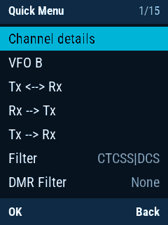 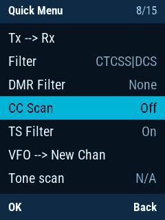 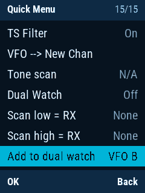

| Fila | Qué hace |
|---|---|
| Detalles del canal | Todos los ajustes de esta VFO (como los detalles del canal) |
| VFO B / VFO A | La tecla de menú en esta fila cambia de VFO |
| Tx <--> Rx | Intercambia las frecuencias |
| Rx --> Tx / Tx --> Rx | Copia la frecuencia de recepción a la de transmisión / al revés |
| Filtro, Filtro DMR, Escaneo CC, Filtro TS | Como en el menú del canal |
| VFO --> Nuevo canal | Guarda la VFO como un canal nuevo ("Nuevo canal N", en Todos los canales) |
| Escaneo de tono | Encuentra el tono CTCSS / DCS que usa la otra estación (cualquier tecla se detiene en el tono encontrado) |
| Doble vigilancia, Añadir a doble vigilancia | Ver [8](#8-doble-vigilancia) |
| Escaneo bajo = RX / Escaneo alto = RX | La frecuencia de recepción pasa a ser el límite inferior / superior del escaneo de la VFO |

---

## 5. Recepción

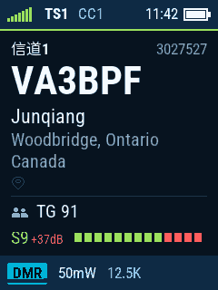 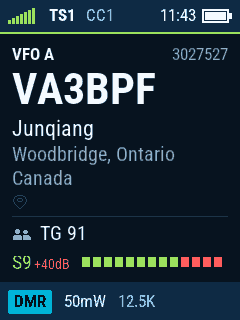

(Estas dos se tomaron con la interfaz en chino: "接收中" es "Recibiendo".)

- Una señal recibida: la línea verde bajo la barra de estado, barras de señal verdes, el valor del medidor S en verde;
  por encima de S9 el exceso se muestra en cifras rojas pequeñas (`+xxdB`).
- DMR: "Recibiendo", el que llama (indicativo o DMR ID, grande), el nombre, el ID, el grupo de llamada. El que llama
  aparece en unos 0.7 s. Los nombres vienen de los contactos y de la base de DMR IDs escrita por el CPS.
- **Si la llamada lleva una posición (ETSI GPS Info, como la mandan otras radios), la pantalla de recepción muestra la
  distancia y el rumbo desde su posición en la línea del ID ("12.3 km NE")**; sin su posición muestra las coordenadas
  del que llama. *Last heard* (últimos escuchados) guarda una distancia corta, o las coordenadas.
- Las llamadas van a *Last heard*. **SK2** devuelve la llamada al grupo de llamada recién escuchado (una llamada
  privada: al que llamó).
- FM: audio cuando se abre el squelch; ▶ ◀ cambian el squelch, se muestra en pantalla un momento.

---

## 6. Transmisión

Mantenga el **PTT** para transmitir, suéltelo para parar. La pantalla de transmisión (sin captura en este manual):

- La barra de estado se pone roja, con `TX` (y el timeslot y el código de color en DMR);
- Área principal: a quién se llama ("Group Call" y el grupo de llamada, o la zona y el canal / VFO), el canal y la
  frecuencia, un temporizador grande (con tiempo límite de transmisión: el tiempo que queda y una barra, ámbar cerca del
  final), un nivel de micrófono de 8 segmentos;
- Repetidoras: "Waking repeater" mientras la despierta, "No repeater" cuando no contesta;
- Cuando la radio no puede transmitir (fuera de banda, canal de sólo recepción, tiempo límite, sin repetidora) el motivo
  queda en pantalla hasta soltar el PTT.

Mientras transmite:

- **FM**: **SK2** manda el tono de 1750 Hz de repetidora; los dígitos mandan DTMF;
- Los tonos de inicio / fin, MDC1200 y la eliminación de cola se ajustan en Opciones de sonido → Tonos de Tx FM;
- **VOX**: Opciones de sonido → Umbral VOX (0 = desactivado) y Cola VOX;
- **PTT fijo** (Opciones de radio): una pulsación del PTT empieza a transmitir, otra lo para.

---

## 7. Escaneo

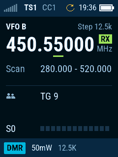

- **SK1 + ▲** escanea hacia arriba, **SK1 + ▼** hacia abajo. En modo canal se escanea la zona (los canales con Saltar
  zona se saltan; en Todos los canales los que tienen Saltar todo); en la VFO entre los límites de escaneo (sin límites:
  toda la banda). La barra de estado muestra el icono de escaneo.
- Mientras escanea: **▲** sigue enseguida; **◀** invierte; cuando se detuvo en una señal, **\*** salta ese canal /
  frecuencia como molesto (para este escaneo); **PTT** detiene el escaneo y transmite; **cualquier otra tecla** lo
  detiene.
- Opciones de radio: Retardo de escaneo (cuánto se queda), Permanencia de escaneo, Modo de escaneo (Hold / Pause / Stop),
  Escaneo al encender.

---

## 8. Doble vigilancia

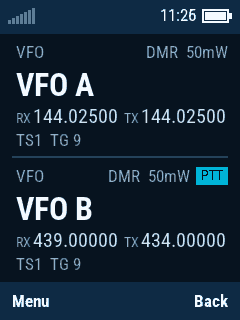

Dos caminos vigilados a la vez, cada uno **cualquier canal o VFO A / B** (los dos pueden ser el mismo).

- Activarla: Doble vigilancia en el menú del canal o de la VFO. Los caminos por defecto son VFO A y VFO B; "Añadir a
  doble vigilancia" en un canal o VFO lo mete (en el camino que se muestra a la derecha; la siguiente adición reemplaza
  el otro camino).
- Los caminos se vigilan por turnos; un camino con señal se mantiene mientras dura la señal y un momento después (para
  la respuesta).
- Transmitir: en el camino escuchado último (tiene la marca `PTT`); ▲ / ▼ fijan el camino superior / inferior para
  transmitir.
- Tecla de menú: el menú principal; tecla de menú mantenida: el menú de doble vigilancia (desactivada, el camino de
  transmisión). Tecla de retorno: vuelve a la vigilancia simple. Se conserva al apagar.

---

## 9. Contactos y a quién se llama

### Introducir un grupo de llamada / llamada privada (#)

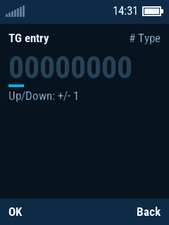

- **#** en una pantalla principal. **#** cicla TG → PC → contacto → ID propio; ▲ ▼ suman / restan 1.
- La tecla de menú lo toma: un TG o PC reemplaza el contacto del canal por ahora; un contacto además trae su timeslot;
  **el ID propio se escribe en el codeplug** (se conserva al apagar).
- En FM # es la entrada DTMF: dígitos, * y # escriben el código, ◀ borra, la tecla de menú lo manda.

### Lista de contactos (SK2 + #)

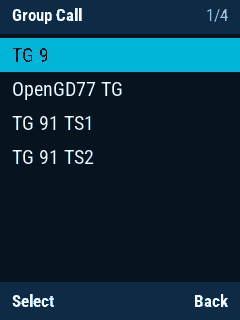

SK2 + # en una pantalla principal: elija uno y pulse la tecla de menú, pasa a ser el destino de transmisión al instante.

### Menú principal → Contactos

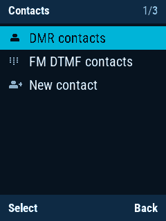  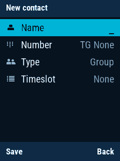

- **Contactos DMR**: un tipo de llamada a la vez, **#** lo cambia (grupo / privada / a todos). La tecla de menú abre las
  acciones: Seleccionar TX, Editar contacto, Borrar contacto (borrar pregunta antes; un grupo de llamada usado por una
  lista de grupos de RX no se puede borrar).
- **Contactos DTMF FM**: números DTMF para FM.
- **Contacto nuevo**: nombre (letras en las teclas de dígitos), número, tipo, timeslot; la tecla de menú lo guarda.

---

## 10. El menú principal

**Mantenga la tecla de menú** en una pantalla principal.

 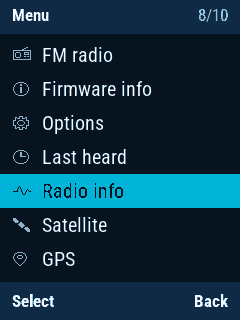

### Zona

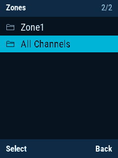

Elija la zona; "Todos los canales" es todos los canales del codeplug.

### RSSI

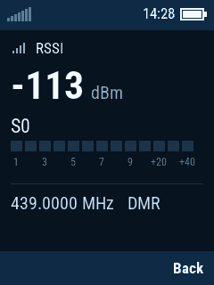

dBm (grande), medidor S, frecuencia y modo. El `*` muestra también las lecturas crudas de señal y ruido.

### Radio FM (SK1)

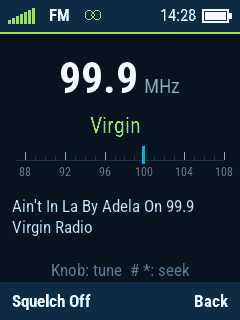

87 – 108 MHz, con el nombre y el texto de la estación RDS, estéreo en la barra de estado.

- Perilla o ◀ ▶: pasos de 100 kHz; **#** / **\***: buscar arriba / abajo; dígitos: una frecuencia (`999` = 99.9 MHz,
  `1071` = 107.1 MHz);
- Tecla de menú: squelch activado / desactivado (silenciado cuando no hay estación);
- Tecla de retorno, SK1 o PTT: salir (el receptor se apaga). La frecuencia y el squelch se conservan; si se apaga desde
  esta pantalla, la radio vuelve a encender en ella.

### Información del firmware

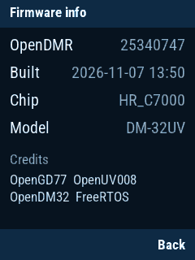

Versión (git commit), hora de la compilación, chip, modelo, créditos.

### Últimos escuchados (Last heard)

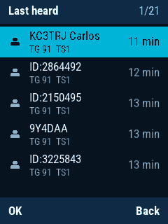

Dos líneas por llamada: el que llama (indicativo y nombre, o ID), el grupo de llamada y el timeslot, cuánto hace que
son en la derecha. ▲ ▼ mueven (SK2 + ▲ ▼: primero / último); tecla de menú: transmitir a ese grupo de llamada desde
ahora (SK2 + tecla de menú: llamada privada al que llamó); con **#** mantenida se limpia la lista.

### Información de la radio

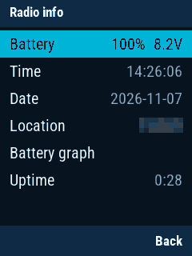

Batería, hora, fecha, posición (localizador Maidenhead), gráfico de batería, tiempo encendido. La tecla de menú en hora,
fecha o posición abre su página para escribirla con los dígitos (la tecla de menú la fija; en la página de posición ▲ ▼
eligen N / S, SK2 + ▲ ▼ E / W). El gráfico de batería tiene un punto cada 40 s (6.4 – 8.2 V).

### Satélite

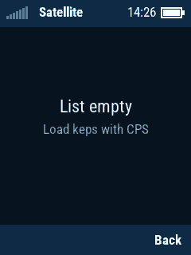

Necesita **la hora y su posición** (Información de la radio, o el GPS) y **las keps de satélites escritas por el CPS**. Ahí:
los pases próximos de todos los satélites; abra uno del pase (rastro polar, acimut / elevación) y las frecuencias
corregidas por Doppler (la tecla de menú cambia voz / APRS / otra). La pantalla del pase sintoniza la radio con la
corrección Doppler, y el PTT transmite en la frecuencia corregida de ese momento. Sin keps: "Lista vacía — Cargar keps
con CPS".

### GPS

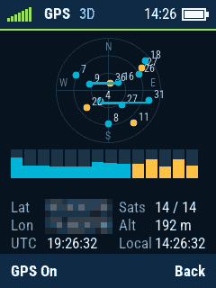

Diagrama de cielo (GPS azul, BeiDou naranja, se llena cuando se usa), barras de señal de los satélites, latitud y
longitud, satélites, altitud, hora UTC y local. **La tecla de menú cambia el GPS encendido / apagado.** Con una posición
fija la hora se fija desde el GPS; APRS y la pantalla de satélites pueden usar la posición del GPS.

---

## 11. Opciones

Menú principal → Opciones. En cada lista de ajustes: ▲ ▼ eligen, **◀ ▶ cambian el valor**, la tecla de menú abre una
sublista o lo alterna, la tecla de retorno vuelve. Los ajustes funcionan al instante y se guardan al apagar. **El CPS no
los lee ni los escribe.**

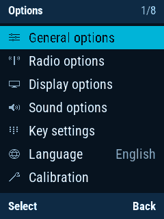

### Opciones generales

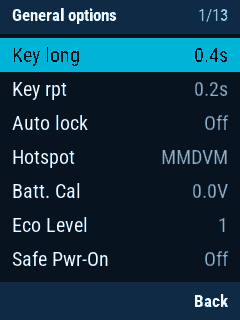 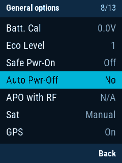

| Fila | |
|---|---|
| Tecla larga / Repetición tecla | Tiempo de pulsación larga; intervalo de repetición de una tecla mantenida |
| Bloqueo automático | Bloquea el teclado y el PTT después de este tiempo sin usar (Apagado / minutos) |
| Hotspot | Apagado / MMDVM / BlueDV (ver [13](#13-cps-hotspot-actualización)) |
| Calibración batería | Corrección de la tensión de batería mostrada (±0.5 V) |
| Nivel eco | Cuánto ahorra el receptor |
| Apagado seguro al encender | Guardado para después: sin efecto en este firmware todavía |
| Apagado automático / APO con RF | Apaga después de este tiempo sin usar; con el segundo activado, una señal recibida cuenta como uso |
| Satélite | Guardado para después (Manual / Auto): sin efecto todavía |
| GPS | Apagado / Encendido / NMEA (oraciones NMEA salidas por el cable de programación) |
| Mantener lugares de menús | Activado: los menús se abren donde se dejaron, también al apagar (desactivado: sólo hasta el apagado) |
| DMR ID de usuario | Su DMR ID; la tecla de menú abre la entrada de número |

### Opciones de radio

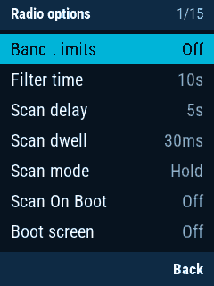 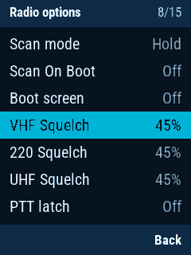 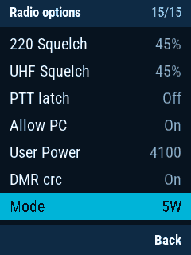

| Fila | |
|---|---|
| Límites de banda | Apagado / Encendido (bandas de radioaficionados) / CPS (como se fijó en el CPS) |
| Tiempo de filtro | Después de que se escuche un grupo de llamada DMR, sólo ese se escucha por esta cantidad de tiempo |
| Retardo de escaneo, Permanencia de escaneo, Modo de escaneo, Escaneo al encender | Ver [7](#7-escaneo) |
| Pantalla de arranque | Pantalla y melodía de arranque al encender (desactivado por defecto: directo a la pantalla principal) |
| Squelch VHF / 220 / UHF | Squelch por defecto de los canales de cada banda |
| PTT fijo | Una pulsación del PTT empieza a transmitir, otra lo para |
| Permitir PC | Apagado / Encendido / PTT (una llamada privada escuchada: el PTT devuelve la llamada) |
| Potencia por defecto | Potencia de un canal nuevo y de una VFO usada la primera vez (cada una conserva la suya después), y la de los canales viejos puestos en "radio" |
| Potencia para todos | La potencia por defecto en todos los canales y en la VFO A / B (pregunta antes) |
| Potencia de usuario | Ganancia del amplificador de la potencia "user" (+W-), 0 - 4100 (pasos de 10 con SK2 mantenida) |
| CRC DMR | Apagado: los errores de CRC de los datos DMR se ignoran |

Niveles de potencia: 50mW, 500mW, 1W, 2W, 3W, 4W, 5W, 7W, 10W, +W-. Los 1W / 4W / 10W son la calibración de fábrica de la
potencia baja / media / alta; los demás se estiman de ellas, no se miden. Cada canal, VFO A y VFO B tiene su propia
potencia: SK2 + ▶ ◀ cambia la que está en uso, y se conserva.

### Opciones de pantalla

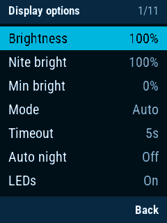 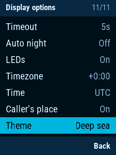

Brillo (día), brillo nocturno, brillo mínimo (la retroiluminación cuando "Apagado"); Modo (Auto / Squelch / Manual /
Teclas), Tiempo de espera; Auto noche; LEDs; Zona horaria (una hora por paso, un cuarto con SK2 mantenida); Hora mostrada
en UTC o en horario local.

### Opciones de sonido

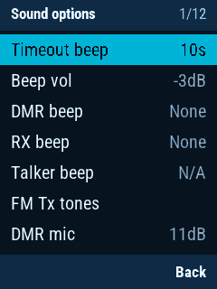 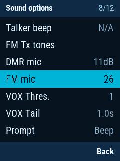

| Fila | |
|---|---|
| Pitido de tiempo límite | Segundos antes de que empiece el aviso en el tiempo límite de transmisión |
| Volumen pitidos | Volumen de los pitidos de teclas y otros pitidos |
| Pitido DMR | Pitidos de inicio / fin de transmisión DMR |
| Pitido RX | Pitido al fin de una portadora / de un hablante |
| Pitido de hablante | Pitido cuando un hablante empieza |
| Tonos de Tx FM | Tonos de transmisión FM (abajo) |
| Micrófono DMR / FM | Ganancia del micrófono de cada modo |
| Umbral VOX / Cola VOX | VOX: 0 = desactivado, lo menor es más sensible; cuánto tiempo sigue transmitiendo después de que usted deja de hablar |
| Aviso | Silencioso / Pitido / Sin teclas (todavía no hay voz) |
| AGC DMR Rx | Ganancia automática de la recepción DMR (desactivado / 0 – 21 dB) |

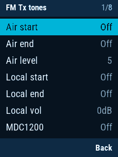

**Tonos de Tx FM**: Inicio aire / Fin aire (mandados por el aire, la otra estación los escucha), Nivel aire; Inicio
local / Fin local (sólo en su parlante), Volumen local; MDC1200 PTT ID (inicio / fin / ambos); Eliminación de cola
(Apagado / Fase 240° / 55 Hz).

### Ajustes de teclas

Ver [12](#12-bloqueo-teclas-rápidas-ajustes-de-teclas).

### Idioma

La tecla de menú o ◀ ▶ en Opciones → Idioma cambia entre Inglés / 中文 / Español.

### Calibración

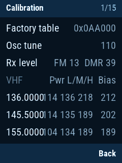

Sólo lectura: la tabla de calibración de fábrica (ajuste de oscilador, nivel de recepción, valores de potencia en cada
frecuencia). **Este firmware nunca cambia la calibración.**

### Opciones APRS

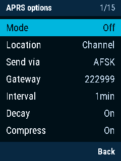 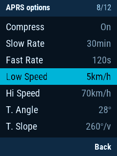

- Modo: Apagado / Manual (SK2 + 2 envía una) / PTT (después de cada transmisión) / Auto (en el intervalo, con decaimiento)
  / Smart (SmartBeaconing);
- Ubicación: la ubicación fija de la configuración APRS del canal, o el GPS;
- Intervalo, Decaimiento, Compresión; para Smart: Velocidad lenta / rápida, Velocidad baja / alta, Ángulo de giro /
  Pendiente / Tiempo.
- SK1 + 1 cambia APRS encendido / apagado en cualquier momento. Las balizas se mandan como AFSK (1200 baud) en FM.

---

## 12. Bloqueo, teclas rápidas, ajustes de teclas

### Bloqueo del teclado

- En el menú principal, **\*** bloquea el teclado, **#** bloquea el PTT (otra vez: desbloquea el PTT); la radio va a inicio.
- Mientras está bloqueado, una tecla muestra la página de bloqueo un momento; **SK2 + \*** desbloquea. Con sólo el teclado
  bloqueado el PTT sigue transmitiendo.
- Opciones generales → Bloqueo automático: bloquea el teclado y el PTT tras un tiempo sin usar.

### Teclas rápidas (SK2 + dígito)

- En una fila de un menú, o en un contacto o zona de sus listas, **SK2 + un dígito** lo guarda en ese dígito (un pitido de
  confirmación).
- En una pantalla principal **SK2 + el dígito** abre ese menú / va a esa zona / usa ese contacto.

### Ajustes de teclas

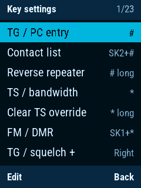 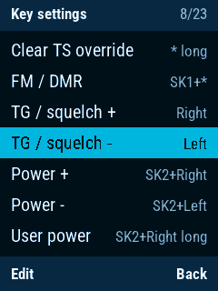 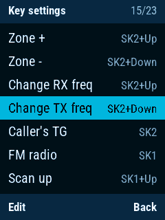

Una fila por acción con sus teclas (los valores por defecto: [1](#atajos-en-las-pantallas-principales-por-defecto)).

- La tecla de menú en una fila, luego las teclas nuevas: SK1 / SK2 mantenidas con otra tecla, pulsación corta o larga, o
  SK1 o SK2 solas. La tecla de retorno deja las teclas viejas.
- La tecla de menú, la de retorno y el PTT no se pueden usar; ▲ ▼ y los dígitos sólo con una tecla lateral.
- Las teclas que pertenecían a otra acción se le quitan a esa (se muestra).
- La última fila devuelve los valores por defecto. Se guarda al salir de la pantalla.

---

## 13. CPS, hotspot, actualización

### Escribir el codeplug (CPS)

El CPS de OpenGD77 (descárguelo de <https://www.opengd77.com/>: ver la [guía de instalación](installation.es.md)),
Radio type **DM32/UV008**. Mientras lee o escribe, la radio muestra qué parte (canales, zonas, contactos, ...) y cómo va.
El CPS no lee ni escribe los ajustes de la radio.

Escribe: canales, zonas, contactos, listas de grupos, contactos DTMF, configuraciones APRS, keps de satélites, la base de
DMR IDs (para los nombres de los que llaman).

### Hotspot DMR (MMDVM)

1. Opciones generales → Hotspot: **MMDVM** o **BlueDV**;
2. Conecte el cable de programación y ejecute MMDVMHost (o BlueDV) en la computadora con el puerto serie del cable;
3. Cuando la computadora empieza a hablar MMDVM, la radio muestra la pantalla del hotspot: las llamadas entrantes y
   salientes o la dirección IP del host, la frecuencia y la potencia.

Simplex (DMO); la frecuencia, el código de color y la potencia las fija el host. El hotspot termina cuando MMDVMHost está
silencioso 20 s; con BlueDV, con la tecla de retorno. El CPS funciona mientras el hotspot está activo.

### Actualización del firmware

Con OpenDMR corriendo y el cable conectado: `python tools\debug\fw_update.py`. Sólo se escriben los sectores cambiados
(unos 35 s), la pantalla muestra el progreso, la radio se reinicia al final. La primera instalación y volver al firmware
original: ver el README.

---

## 14. Límites actuales

- Sin indicaciones de voz (la radio no tiene datos de voz).
- La calibración es de sólo lectura: no se pueden cambiar la potencia ni el oscilador.
- Sin temas: la interfaz tiene colores fijos.
- Apagado seguro al encender y Satélite (Manual / Auto) todavía no tienen efecto.
- P25: sólo llamadas de grupo simplex en claro; problemas conocidos en [docs/p25.md](p25.md), sección 6.
- Todavía no probado en el aire a fondo: decodificación APRS, el ID CW del hotspot, pases de satélites, talkaround,
  orden por distancia.
